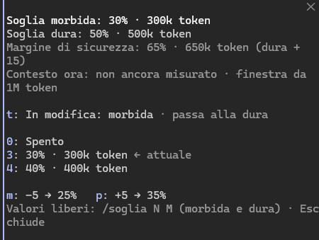

# auto-clear-context

A **Claude Code** mod that keeps long sessions going on its own: near the context thresholds Claude saves its state in a validated handoff, the mod runs `/clear` and the work resumes by itself in the clean session.

*Mod per Claude Code: vicino alle soglie di contesto Claude salva lo stato in un handoff validato, la mod esegue `/clear` e il lavoro riparte da solo nella sessione pulita.*

**[English](#english)** · **[Italiano](#italiano)**

---

## English

As a Claude Code session grows, the context window fills up and the work has to be cleared and rebuilt by hand. auto-clear-context automates that loop. When usage crosses a threshold, the mod tells Claude to write a *handoff* of the work in progress; a fresh read-only subagent rebuilds the task from that file alone and lists the gaps; once the handoff is marked validated, the mod runs `/clear` at the end of the turn, attaches the handoff to the new session and resumes from its "next step". No typing needed.

The mod nudges, it does not force: it adds a note to Claude's context once per zone, and Claude decides when to hand off by following the skill's rules. If no handoff is made, Claude Code's own auto-compact, when enabled, remains the fallback. The mod's messages, the `/soglia` panel and the skill are written in Italian (*soglia* = threshold, *morbida* = soft, *dura* = hard).

### What it contains

| Part | Role |
| --- | --- |
| Hooks module (`mod/hooks/register.tsx`) | Measures context usage, tells Claude when it enters a zone, runs `/clear` and the resume; registers the `/soglia` command and the `context_usage` tool |
| Skill `auto-clear-context:handoff` (`mod/skills/handoff/`) | Writes `.claude/handoff/pending.md`, has it checked by the validator, marks it `status: validated` |
| Agent `auto-clear-context:handoff-validator` (`mod/agents/`) | Read-only subagent (Read, Glob, Grep): rebuilds the work from the handoff alone and lists the gaps |

### How it works

| Zone | Default | With a 1M-token window | What Claude is told to do |
| --- | --- | --- | --- |
| Normal | below 40% | up to 400k | keep working |
| Soft | from 40% | 400k | hand off at the next natural point: a finished, verified sub-task, or before opening a new file or feature |
| Hard | from 60% | 600k | finish the atomic action in progress and hand off at the first safe point, recording unfinished work under "Lavoro interrotto" (interrupted work) |
| Safety margin | from 75% (hard + 15) | 750k | hand off immediately, even with work half done |

Each zone is signalled at most once per session (only the highest one if usage jumps past several), either with the next prompt or mid-turn, checked after tool calls at most every 30 s. After a compact the zones re-arm, and if auto-compact fires before the clear, a validated handoff is attached to the compacted session instead. A typical cycle in the transcript (values illustrative):

```text
auto-clear-context: contesto al 41% (zona morbida, soglie 40/60/75%): la nota parte con il prossimo prompt
auto-clear-context: zona morbida segnalata a Claude insieme al prompt
auto-clear-context: handoff 9b1c4e2a1f3c validato: eseguo /clear
auto-clear-context: clear eseguito: invio il prompt di ripresa
auto-clear-context: handoff 9b1c4e2a1f3c allegato alla sessione (clear) e archiviato in .claude/handoff/archive/2026-10-12T10-15-00-000Z-9b1c4e2a1f3c.md
```

In order: the soft zone is reached at 41% and the note goes out with the next prompt; the handoff is validated and the mod runs `/clear`; the resume prompt is sent; the handoff is attached to the new session and archived.

In the project the mod uses `.claude/handoff/`: `pending.md`, `archive/` and `events.log`.

### Install

Installation runs **from a terminal**. Installed with the `user` scope, the mod also applies to the Code tab of the desktop app on the same machine (the install command is not available there). Open new sessions after installing.

In a Claude Code terminal session:

```text
/plugin install auto-clear-context --marketplace IndjiWR/auto-clear-context
```

Answer `y` to add the marketplace and pick the `user` scope. Or from a shell:

```bash
claude plugin install auto-clear-context --marketplace IndjiWR/auto-clear-context --scope user
```

From a local clone (`git clone https://github.com/IndjiWR/auto-clear-context.git`), pass its path instead: `claude plugin install auto-clear-context --marketplace <path-to-clone> --scope user`. The plugin is then read from that folder, so don't move or delete it.

Update with `claude plugin update auto-clear-context`.

### Configuration

| Option | Default | Accepted by `/soglia` | Meaning |
| --- | --- | --- | --- |
| `threshold` | 40 | 0, or 1–85 and at least 10 below hard | soft zone (%); `0` turns the monitor off |
| `hardThreshold` | 60 | soft + 10 to 95 | hard zone (%) |
| `maxClearsPerHour` | 3 | — | automatic clears per rolling hour; `0` disables them; above 20 means no cap (the mod keeps only the last 20 clears) |

The safety margin is always hard + 15, capped at 95%. Only `/soglia` checks the ranges above: values set in `/config` or at install are taken as given, except that the hard threshold in force is raised to at least soft + 10 and capped at 95.

Ways to set them:

- at install time: `claude plugin install auto-clear-context --marketplace IndjiWR/auto-clear-context --config threshold=45`;
- in `/config`, where the plugin's options are listed;
- with `/soglia`: `/soglia 45` sets the soft threshold, `/soglia 45 65` soft and hard (use it to move both when the soft one would end up less than 10 below the hard one), `/soglia morbida 45` or `/soglia dura 65` one of them, `/soglia 0` (or `off`) turns the monitor off. `/soglia` alone opens a panel with presets and their token counts (terminal keys: digits for presets, `t` to switch between soft and hard, `m`/`p` for −5/+5, `Esc` to close).

Where `/config` has no rows for the plugin (headless sessions, the desktop Code tab), `/soglia` saves the values in the mod's own store. They apply at once in every session and take precedence over `/config` from then on; set the `/config` value again with `/soglia` to drop the override.



*The `/soglia` panel in a terminal session, here with soft 30% and hard 50% on a 1M-token window.*

Claude can read the current usage and zone with the mod's `context_usage` tool, which answers with one line such as `47% · zona morbida (40/60%)`. To hand off by hand, ask Claude to use the `auto-clear-context:handoff` skill.

### Safety limits

- **Only a handoff marked validated clears.** The mod runs `/clear` only when the frontmatter of `.claude/handoff/pending.md` says `status: validated`, which the skill sets after up to 2 rounds with the read-only validator. A draft never triggers a clear. The mod trusts that flag: it reads only the frontmatter, so a file marked validated by hand clears too.
- **One clear per handoff**, and at most `maxClearsPerHour` (default 3) per rolling hour; past that the handoff waits.
- **Never with work in flight.** No clear while a subagent is pending, running or waiting, after an interrupted turn, or at the end of a subagent's turn. In every zone the skill makes Claude wait for or stop background work first. In the soft and hard zones the skill and the zone notes also rule out handing off mid-edit, mid-debug or with a question to the user pending; whatever is left unfinished in the hard zone or the safety margin goes into the handoff's interrupted-work section.
- **Bounded retry.** If `/clear` fails the mod retries once after 300 ms, then gives up and logs why. That handoff then counts as used: change it and validate it again to get a new clear.
- **Everything is visible.** Every step shows up in the transcript (`auto-clear-context: …` lines) and in `.claude/handoff/events.log` (last 300 events).
- **Kept out of git.** When the project root has a `.git` directory, the mod adds `.claude/handoff/` to `.git/info/exclude`, which is local and never committed. The skill also tells Claude to keep handoffs under 9,000 characters and free of secrets; the mod does not check either.

### Known limits

- The "Ripristina /config" (restore `/config`) button of the `/soglia` panel does not work yet in real sessions, although the test kit's version of the flow passes: set the value with `/soglia N`.
- The mod cannot see background commands (Bash, monitors); the skill makes Claude wait for them or stop them before the handoff.
- The git exclude is skipped in worktrees and submodules, where `.git` is a file.
- Claude Code only (terminal and the desktop Code tab); it does not run in claude.ai chats.
- Organization policies can block personal mods: if `/status` shows "Enterprise managed settings", ask your admin.

### Early-access mods API

Mods are in **early access**: the hooks API this module is built on (`register`, `$.session`, `$.command`, `$.ui`, `$.state`, the `claude-code/testing` kit) can change between Claude Code releases, and a new release can break the mod until it is updated. Check the versions below before relying on it.

### Tested Claude Code versions

| Version | Surface | Result |
| --- | --- | --- |
| 2.1.296 | `claude plugin test mod` (Windows 11) | 28 of 28 tests pass; `claude plugin validate` passes |
| 2.1.296 | terminal | manual tests in real sessions |
| 2.1.295 | desktop app, Code tab (Windows) | manual tests in real sessions |
| 2.1.212 | any | not supported: no mods API |

The one-line `/plugin install … --marketplace` form needs Claude Code 2.1.275 or later. Check your version with `claude --version` and update with `claude update`.

### How it is built

One TypeScript/TSX hooks module on the mods API:

| Event | Role |
| --- | --- |
| `session.measure`, `classic.PostToolUse` | watch context usage after each turn and during long turns |
| `prompt.submit` | attaches the zone note to the next prompt |
| `turn.complete` | checks the handoff, the caps and running subagents, then runs `/clear` |
| `session.end` | submits the resume prompt after the clear |
| `classic.SessionStart` | attaches the validated handoff to the new session and archives it |
| `session.start`, `command.run`, `ui.render`, `tool.call` | register and serve `/soglia`, its panel and `context_usage` |

Zone flags live in `$.state` and are written with `ifVersion`, so the two monitor channels never signal the same zone twice. A two-value threshold change parks its second write in `$.state`, so it survives the module reload that a `/config` write triggers. The tests use the official `claude-code/testing` kit and render the `/soglia` panel on both the terminal and the desktop surface.

### Development

```text
.claude-plugin/marketplace.json   marketplace entry pointing at ./mod
mod/.claude-plugin/plugin.json    manifest and userConfig options
mod/hooks/hooks.json              loads register.tsx
mod/hooks/register.tsx            the hooks module
mod/types/index.d.ts              the $.state contract
mod/skills/handoff/SKILL.md       handoff skill
mod/agents/handoff-validator.md   read-only validator agent
mod/tests/*.test.ts               tests (claude-code/testing)
mod/tsconfig.json                 extends the types the engine writes
```

Run `claude plugin validate .` (marketplace), `claude plugin validate mod` (manifest and module) and `claude plugin test mod` (tests). To try the mod from a clone without installing it, start Claude Code with `claude --plugin-dir mod`; the engine then writes the API types into `mod/.claude-plugin/types/`, which `mod/tsconfig.json` extends.

### Uninstall

```bash
claude plugin uninstall auto-clear-context
```

Any `.claude/handoff/` folders in your projects can then be deleted by hand.

---

## Italiano

Mod per **Claude Code** che gestisce da sola le conversazioni lunghe. Quando il contesto si riempie, Claude salva lo stato del lavoro in un *handoff*, un subagent lo verifica, la mod esegue `/clear` e il lavoro riparte da solo nella sessione pulita, con l'handoff allegato. Non serve scrivere niente.

### Cosa contiene

| Parte | Cosa fa |
| --- | --- |
| Mod (`mod/hooks/register.tsx`) | Misura il contesto, avvisa Claude quando entra in una zona, esegue `/clear` e la ripresa; comando `/soglia`; tool `context_usage` |
| Skill `auto-clear-context:handoff` (`mod/skills/handoff/`) | Scrive `.claude/handoff/pending.md`, lo fa validare e lo segna come validato |
| Agent `auto-clear-context:handoff-validator` (`mod/agents/`) | Subagent in sola lettura: ricostruisce il lavoro dal solo handoff ed elenca le lacune |

### Come funziona

| Zona | Default | Con una finestra da 1M token | Cosa fa Claude |
| --- | --- | --- | --- |
| Normale | sotto il 40% | fino a 400k | lavora normalmente |
| Morbida | dal 40% | 400k | fa l'handoff al prossimo punto naturale (sotto-task finito e verificato, prima di un file o una feature nuova) |
| Dura | dal 60% | 600k | fa l'handoff al primo punto sicuro, anche con lavoro a metà (lo descrive in "Lavoro interrotto") |
| Margine di sicurezza | dal 75% (dura + 15) | 750k | fa l'handoff subito |

Nelle zone morbida e dura mai a metà di un edit o di un debug; in nessuna zona con lavoro in background attivo.

Dopo l'handoff validato, a fine turno la mod esegue `/clear`, allega l'handoff alla sessione nuova e fa ripartire il turno dal "prossimo passo".

Sicurezze:
- un solo clear per handoff, al massimo 3 clear all'ora (opzione `maxClearsPerHour`);
- nessun clear con subagent ancora attivi;
- ogni passaggio compare nel transcript (righe `auto-clear-context: …`) e in `.claude/handoff/events.log`.

Nel progetto la mod usa la cartella `.claude/handoff/`, con `pending.md`, `archive/` ed `events.log`. Se la root del progetto ha una cartella `.git`, la aggiunge da sola a `.git/info/exclude`, così non finisce in un commit.

### Requisiti

- **Solo Claude Code**: terminale e tab Code dell'app desktop. Non funziona nelle chat di claude.ai.
- **Claude Code recente.** Provata su 2.1.295 (tab Code dell'app desktop, Windows) e 2.1.296 (terminale); la 2.1.212 non supporta le mods. Controlla con `claude --version` (aggiorna con `claude update`) o con `/status`.
- **Early access.** Le mods sono in early access e l'API può cambiare tra una versione e l'altra.
- **Account aziendali.** Le policy dell'organizzazione possono bloccare le mod personali. Se `/status` mostra "Enterprise managed settings", chiedi all'admin.

### Installazione

L'installazione si fa **dal terminale**. Installata con scope `user`, la mod vale anche per il tab Code dell'app sulla stessa macchina (lì il comando di installazione non è disponibile). Dopo l'installazione apri sessioni nuove.

#### Da GitHub

In una sessione di Claude Code nel terminale:

```text
/plugin install auto-clear-context --marketplace IndjiWR/auto-clear-context
```

Rispondi `y` per aggiungere il marketplace e scegli lo scope `user`. In alternativa, da una shell:

```bash
claude plugin install auto-clear-context --marketplace IndjiWR/auto-clear-context --scope user
```

Per aggiornare a una nuova versione:

```bash
claude plugin update auto-clear-context
```

#### Da un clone locale

```bash
git clone https://github.com/IndjiWR/auto-clear-context.git
```

```bash
claude plugin install auto-clear-context --marketplace <percorso-del-clone> --scope user
```

Il plugin viene letto da quella cartella: non spostarla e non cancellarla.

### Uso

- **Automatico.** Non serve fare niente: le righe `auto-clear-context: …` mostrano i passaggi.
- **`/soglia`** apre un pannello per scegliere le soglie, ognuna con i token corrispondenti. In alternativa:
  - `/soglia 45` imposta la morbida;
  - `/soglia 45 65` imposta morbida e dura;
  - `/soglia 0` spegne il monitor.
- **Handoff a mano.** Chiedi a Claude: "usa la skill auto-clear-context:handoff".
- **Contesto attuale.** Claude può controllarlo con il tool `context_usage` della mod.


### Limiti noti

- Il pulsante "Ripristina /config" del pannello `/soglia` non funziona ancora: imposta il valore con `/soglia N`.
- I comandi in background (Bash, monitor) la mod non li vede: la skill fa aspettare o fermare Claude prima dell'handoff.
- Nei worktree e nei submodule, dove `.git` è un file, l'esclusione da git non viene aggiunta.

### Sviluppo

```bash
claude plugin validate .
```

```bash
claude plugin test mod
```

Il primo comando controlla il marketplace, `claude plugin validate mod` il manifest e il modulo; il secondo esegue i test in `mod/tests/` con il kit `claude-code/testing`. Per provare la mod da questa cartella senza installarla: `claude --plugin-dir mod`.

### Disinstallazione

```bash
claude plugin uninstall auto-clear-context
```

Le cartelle `.claude/handoff/` nei progetti si possono cancellare a mano.

---

## License / Licenza

[MIT](LICENSE)
